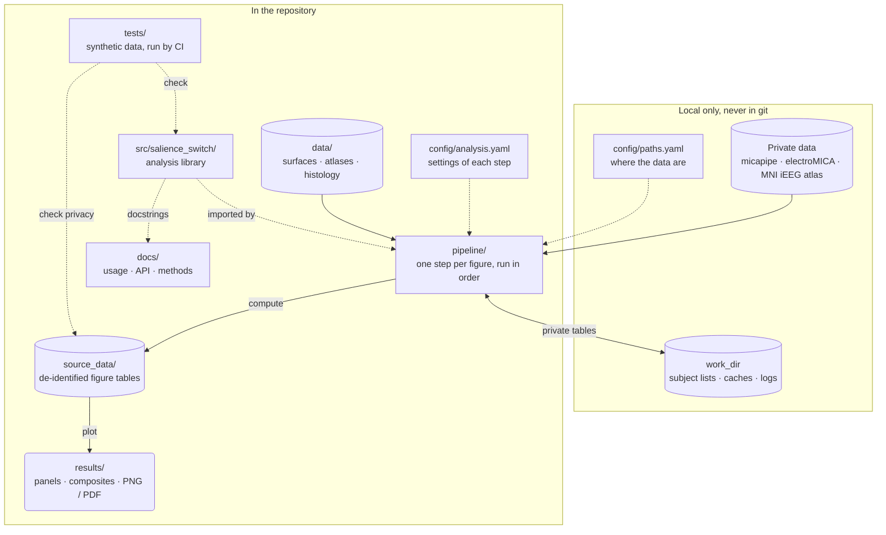
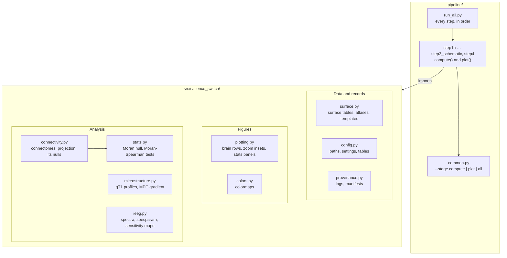
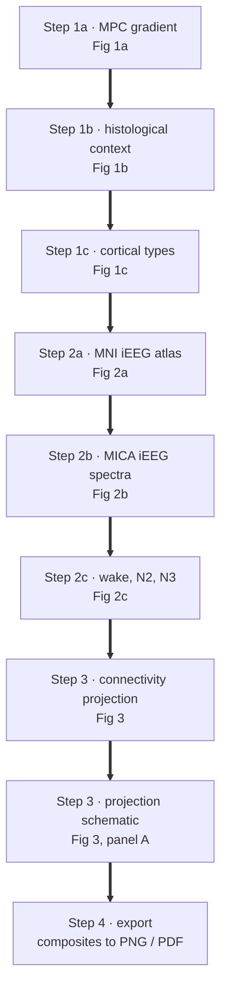
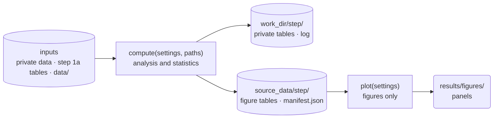
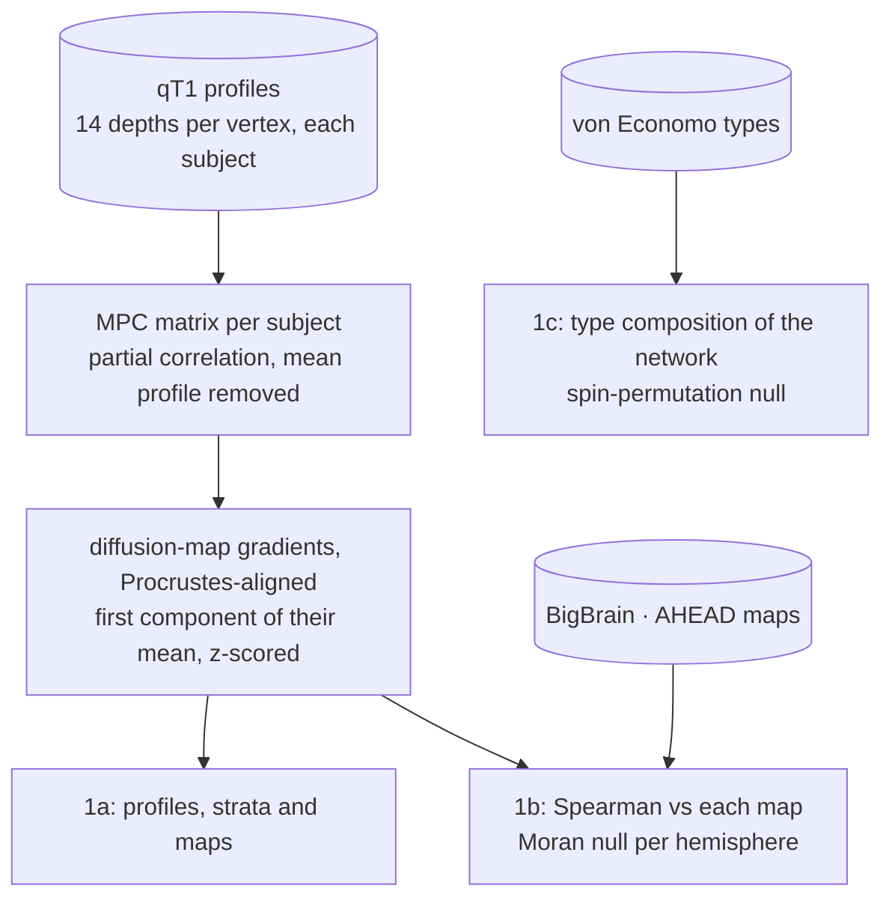
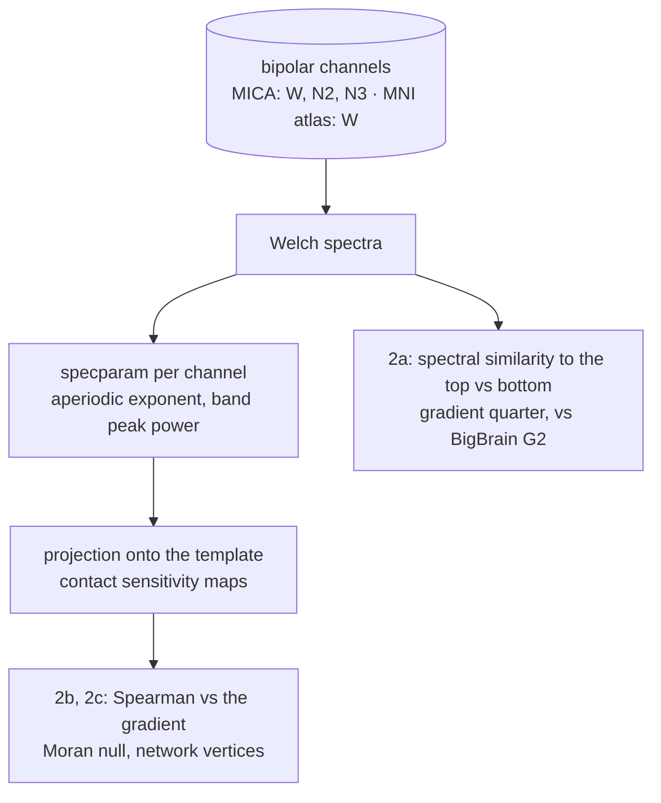
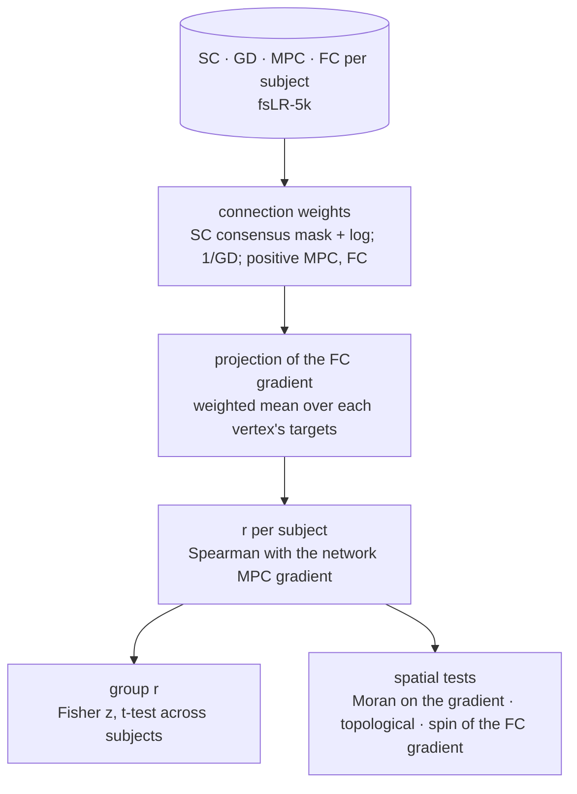

# How the repository works

The analyses run as a pipeline of steps, one per figure, in figure order: step 1
(Figure 1) to step 3 (Figure 3), then step 4 exports the composite figures. Every step
has two stages: **compute** reads the data and writes the tables behind its figures to
`source_data/`; **plot** draws the figures from those tables alone. The participants'
data never enter the repository: they stay on the computing machine, with every table
that could identify a participant, in a private work directory.

Each section below is one view of the same code and can be read on its own. The
diagrams render on GitHub, on the documentation site, and in VS Code with a Mermaid
extension.

## 1. The repository at a glance

## 2. Modules

`pipeline/run_all.py` runs the steps in order; each step is one file in `pipeline/`
and shares its command line (`--stage compute|plot|all`) through `pipeline/common.py`.
The steps use the library in `src/salience_switch/`, which holds no figure logic, no
paths and no study constants, so it can be reused on other data. Within the library,
only `connectivity` imports another module (`stats`).

## 3. Steps, in the order they run

Step 1a comes first: it builds the subject list and the microstructural gradient that
every later step reads. The other steps follow in figure order.

| Step | Reads | Private (`work_dir`) | Public (`source_data/`) |
|---|---|---|---|
| 1a | micapipe qT1 profiles; participant table | subject lists with file paths; gradient fits with subject IDs | surface tables with the gradient; subject-mean qT1 profiles; gradient fit summary; comparison with the FC gradient |
| 1b | step 1a gradient; BigBrain, AHEAD maps in `data/` | — | histological maps; statistics; Moran nulls |
| 1c | atlases in `data/` | — | type composition; spin nulls; statistics |
| 2a | MNI iEEG atlas and its registered surfaces; step 1a gradient | — | per channel: template vertex, network, ES difference, BigBrain G2; statistic |
| 2b | electroMICA recordings and sensitivity maps; step 1a gradient | channel spectra | template maps of each measure; statistics; nulls; quintile spectra; similarity projection |
| 2c | as step 2b, for three states | channel spectra per state | template maps per state; band powers; statistics; nulls |
| 3 | step 1a gradient and subject list; SC, GD, MPC, FC connectomes | per-subject correlations | vertex-wise group projections; statistics; nulls; control |
| 3 schematic | as step 3 | example subject's ID | that subject's projection; connections of one vertex; summary |

Steps 1b and 1c read only public inputs, so they can be recomputed without the private
data; every step can be redrawn from `source_data/` alone.

## 4. Inside a step

The two stages communicate only through files. `compute` writes a `manifest.json` next
to the tables: the code version, the package versions, the settings and the sample
sizes of the run. Figures of individual channels (specparam fit quality, channel
similarity matrix) are drawn by `compute`, because their data are not public.

## 5. Figure 1: microstructure

## 6. Figure 2: intracranial EEG

## 7. Figure 3: connectivity

## Where to change what

| To change | Edit |
|---|---|
| where the data are on your machine | `config/paths.yaml` (copy `config/paths.example.yaml`) |
| a step's network, hemisphere or number of permutations | `config/analysis.yaml` |
| any other parameter | the named constant at the top of the step (`pipeline/`) or library module |
| an analysis method | its module in `src/salience_switch/`, with a test in `tests/` |
| how a figure looks | the plot functions of its step; shared panels are in `plotting.py` |
| add a figure | a new step file with `compute()` and `plot()`, its name in `pipeline/run_all.py`, its settings in `config/analysis.yaml` |
| the composite layouts | `results/figure*.svg` in Inkscape (panels are linked by file name) |
| the documentation | `docs/` (the API pages come from the docstrings) |

## What is public and what is private

| Public, in git | Private, in `work_dir` only |
|---|---|
| code, tests, documentation | participant table, subject lists, file paths |
| template surfaces, atlases and histological maps (`data/`) | per-subject and per-channel tables, spectra caches |
| figure tables without identifiers (`source_data/`) and their manifests | run logs |
| figures (`results/`) | MNI iEEG atlas files |

`.githooks/pre-commit` refuses commits of private file types or of participant IDs
(enable it once per clone with `git config core.hooksPath .githooks`), the CI repeats
that check on every push, and `tests/test_pipeline.py` checks that `source_data/` holds
no identifier.
